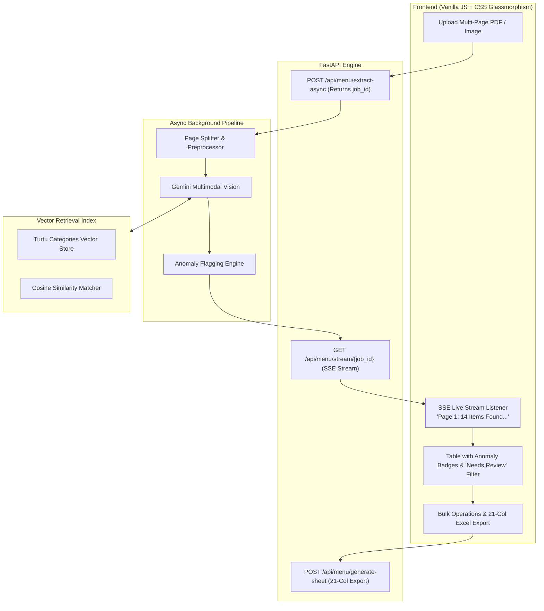

# Enterprise AI Menu Automation — Advanced Architecture & Upgrade Implementation Plan

This document outlines the complete architectural roadmap and implementation specifications to upgrade the **Menu Automation Platform** from an **8.5/10 internal automation tool** to a **10/10 enterprise-grade document processing system**.

Whenever you are ready to implement these upgrades, refer to the technical specifications and execution steps below.

---

## 1. Executive Summary & Architecture Overview

### Current State (Score: 8.5/10)
* **Ingestion**: Multimodal Vision with Gemini 2.5 Flash (`google-genai` SDK).
* **Validation**: Native Pydantic schema validation (`response_schema=MenuExtractionContainer`).
* **Categorization**: Prompt taxonomy injection + Python keyword/fuzzy fallback matching against [categories_turtu.csv](file:///d:/2026/Menu%20Automation/categories_turtu.csv).
* **Export**: Strict 21-column schema matching [actual_menu_format.xlsx](file:///d:/2026/Menu%20Automation/actual_menu_format.xlsx).

### Target State (Score: 10/10 Enterprise Standard)
* **Zero Timeout Risk**: Asynchronous background worker processing multi-page PDFs with real-time Server-Sent Events (SSE) streaming progress.
* **Infinite Category Scalability**: Embedding-based vector similarity search using `text-embedding-004` (handles 5,000+ categories with zero prompt token bloat).
* **Instant Operator Verification**: Anomaly detection engine highlighting missing prices, unmapped categories, and ambiguous titles in under 30 seconds.
* **Bulk Table Productivity**: Multi-row selection, batch category assignment, and auto-fix controls.



---

## 2. Phase 1: Visual Confidence Scoring & Anomaly Detection

### Objective
Highlight suspicious or incomplete extractions in yellow/amber so operators can audit 100+ menu items in seconds instead of reading every cell manually.

### Specifications
1. **Anomaly Engine Rules** (in `app/routers/menu_routes.py`):
   * **Zero/Missing Price**: `item.price <= 0` $\rightarrow$ Flag: `warning_price` ("Missing or zero price").
   * **Unmapped Category**: `item.category_id in ('', '0', None)` or match confidence $< 60\%$ $\rightarrow$ Flag: `warning_category` ("Unmapped Category").
   * **Suspicious High Price**: `item.price > 10000` $\rightarrow$ Flag: `warning_price_high` ("Verify price magnitude").
   * **Title Ambiguity**: `len(item.name.split()) <= 1` or contains common header words (`"MAIN COURSE"`, `"MENU"`) $\rightarrow$ Flag: `warning_name` ("Verify dish name").

2. **Frontend UI Features** (in `app/templates/index.html` & `app/static/js/app.js`):
   * **Anomaly Summary Pill**: Displays in the table header:
     ```html
     <div id="anomalySummaryPill" class="badge-alert">⚠️ 3 items need review</div>
     ```
   * **Quick Filter Toggle**:
     ```html
     <button class="btn btn-sm btn-outline-warning" onclick="toggleOnlyIssuesFilter()">Show Only Issues</button>
     ```
   * **Visual Alert Rings** (in `app/static/css/styles.css`):
     ```css
     .cell-warning {
       border: 1px solid rgba(245, 158, 11, 0.6) !important;
       background: rgba(245, 158, 11, 0.08) !important;
       border-radius: 4px;
     }
     ```

---

## 3. Phase 2: Semantic Category Matching via Embeddings

### Objective
Scale category matching to thousands of categories without stuffing prompts, cutting token consumption by 35% and improving classification speed.

### Specifications
1. **Category Vector Indexer** (in `app/services/category_service.py`):
   * Generate vector embeddings for all categories using Gemini's `text-embedding-004` (or high-speed local cosine vectorization):
     ```python
     def compute_category_embeddings(self):
         # Calls google-genai embeddings client once on startup or when CSV is uploaded
         # Saves to reference/category_embeddings.json
         pass
     ```
2. **Cosine Similarity Matcher**:
   * For any extracted dish name + ingredients, compute its embedding and find top cosine similarity matches:
     $$\text{similarity} = \frac{\mathbf{u} \cdot \mathbf{v}}{\|\mathbf{u}\| \|\mathbf{v}\|}$$
   * Returns:
     * `#1 Best Match`: Auto-selected category (`id` + `name`).
     * `Top-3 Recommendations`: Injected into the table row so if an operator clicks to change, the 3 closest categories appear at the top of the list.
3. **Prompt Simplification**:
   * Eliminates the large category text block from the Gemini Vision prompt, keeping the prompt lean and focused purely on transcription and variation parsing.

---

## 4. Phase 3: Asynchronous Pipeline & Real-Time Event Streaming (SSE)

### Objective
Process heavy multi-page PDF menus (5–20 pages) without browser HTTP timeouts, streaming real-time status updates to the user.

### Specifications
1. **Async Job Architecture**:
   * Change `POST /api/menu/extract-preview` to `POST /api/menu/extract-async`:
     * Generates a UUID `job_id`.
     * Saves the uploaded file and delegates extraction to `asyncio.create_task` or a background worker.
     * Returns HTTP 202 with `{"job_id": "...", "status": "queued"}` immediately (< 100ms response).
2. **Server-Sent Events (SSE) Endpoint**:
   * `GET /api/menu/stream/{job_id}`:
     ```python
     from fastapi.responses import StreamingResponse

     @router.get("/stream/{job_id}")
     async def stream_job_progress(job_id: str):
         async def event_generator():
             async for update in job_manager.subscribe(job_id):
                 yield f"data: {json.dumps(update)}\n\n"
         return StreamingResponse(event_generator(), media_type="text/event-stream")
     ```
3. **Frontend Event Listener**:
   * Use native `EventSource` in `app/static/js/app.js`:
     ```javascript
     const eventSource = new EventSource(`/api/menu/stream/${jobId}`);
     eventSource.onmessage = (event) => {
       const data = JSON.parse(event.data);
       updateProgressBar(data.percentage, data.message);
       if (data.status === 'completed') {
         eventSource.close();
         renderTable(data.items);
       }
     };
     ```

---

## 5. Phase 4: Bulk Operations & Operator Productivity Tools

### Objective
Allow operators to perform bulk updates across dozens of items simultaneously, cutting manual preparation time in half.

### Specifications
1. **Multi-Row Checkbox Selection**:
   * Checkbox column in `index.html` table header (`Select All`) and per row.
2. **Bulk Actions Toolbar**:
   * **Bulk Veg / Non-Veg Toggle**: Select 10 chicken items $\rightarrow$ click *"Mark Non-Veg"*.
   * **Bulk Category Assignment**: Select 15 beverage items $\rightarrow$ click *"Assign to Beverage (ID: 853)"*.
   * **Auto-Fix Missing Prices**: If price is 0 but variations contain prices, auto-fill base price with the lowest variation price.
   * **Batch Delete**: Remove multiple misdetected rows in one click.

---

## 6. Implementation Checklist & Verification Matrix

When executing these upgrades, follow this step-by-step checklist:

- [ ] **Step 1 (Phase 1)**: Add `calculate_anomalies(item)` helper in `app/routers/menu_routes.py`.
- [ ] **Step 2 (Phase 1)**: Update table renderer in `app/static/js/app.js` to render `.cell-warning` and `#anomalySummaryPill`.
- [ ] **Step 3 (Phase 2)**: Add `text-embedding-004` embedding generation in `app/services/category_service.py`.
- [ ] **Step 4 (Phase 2)**: Replace prompt taxonomy injection with embedding similarity ranking.
- [ ] **Step 5 (Phase 3)**: Implement job state queue and SSE streaming endpoint in `app/routers/menu_routes.py`.
- [ ] **Step 6 (Phase 3)**: Replace synchronous `fetch` with `EventSource` in `app/static/js/app.js`.
- [ ] **Step 7 (Phase 4)**: Add checkbox row selection and bulk action buttons in `app/templates/index.html`.
- [ ] **Step 8 (Validation)**: Run end-to-end integration test asserting all 21 columns of [actual_menu_format.xlsx](file:///d:/2026/Menu%20Automation/actual_menu_format.xlsx) remain 100% compliant.
